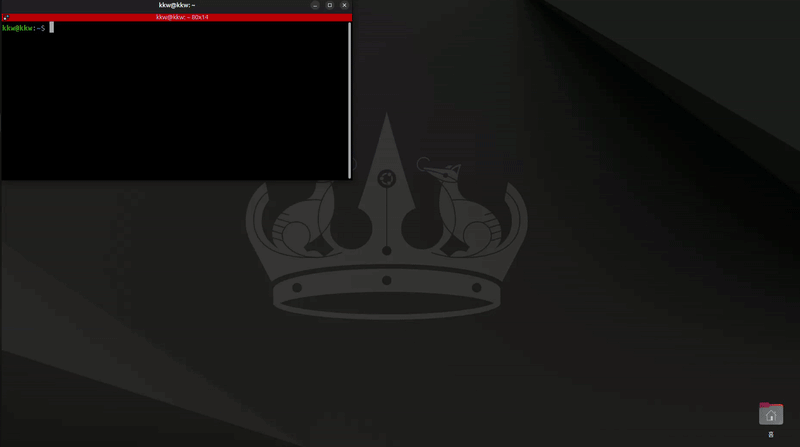
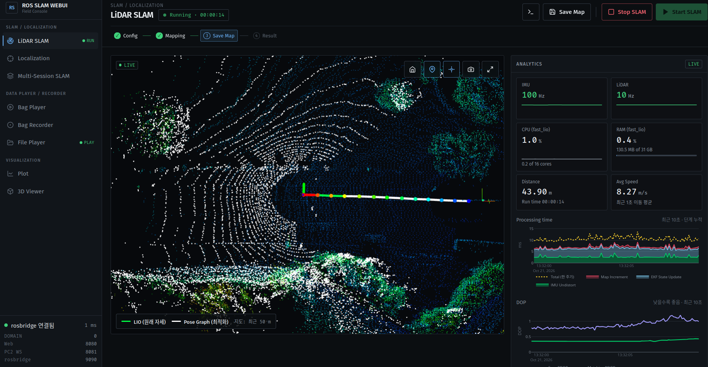
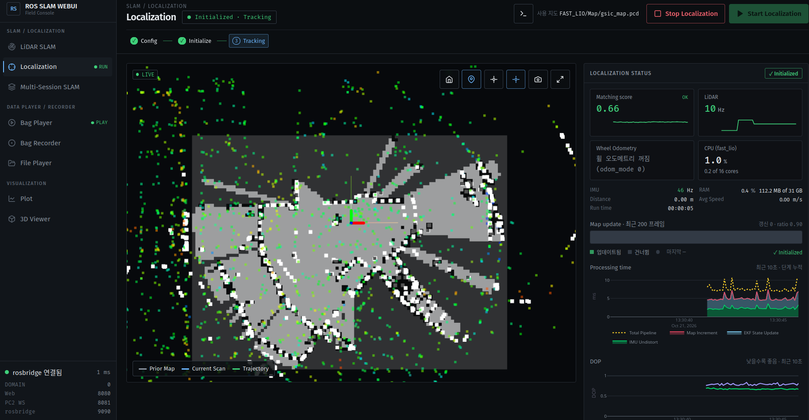
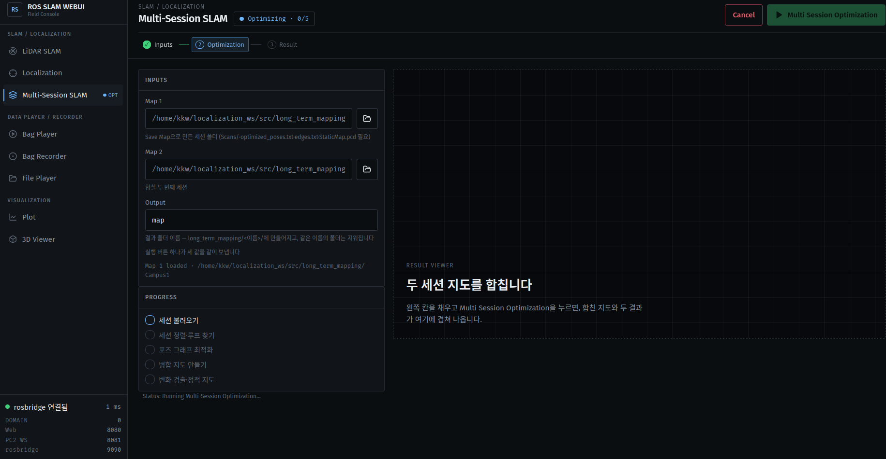
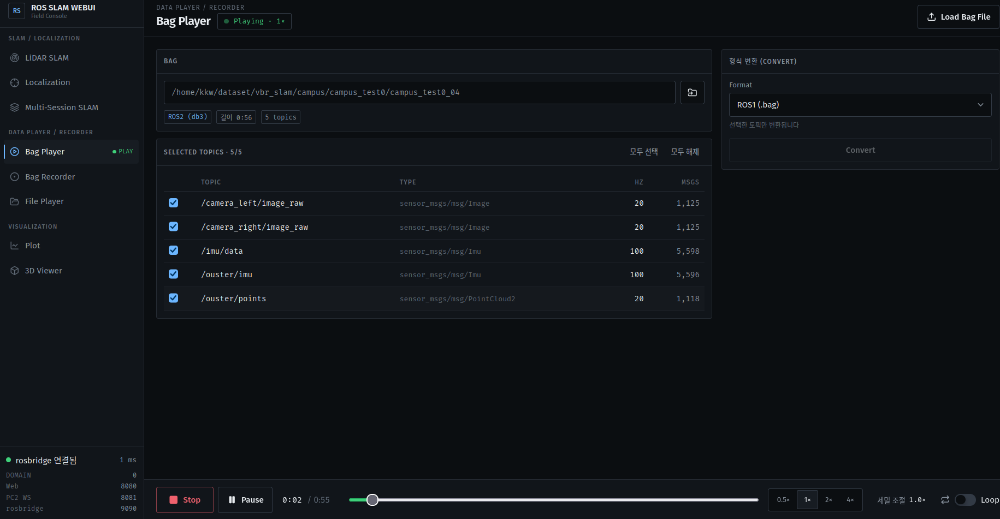
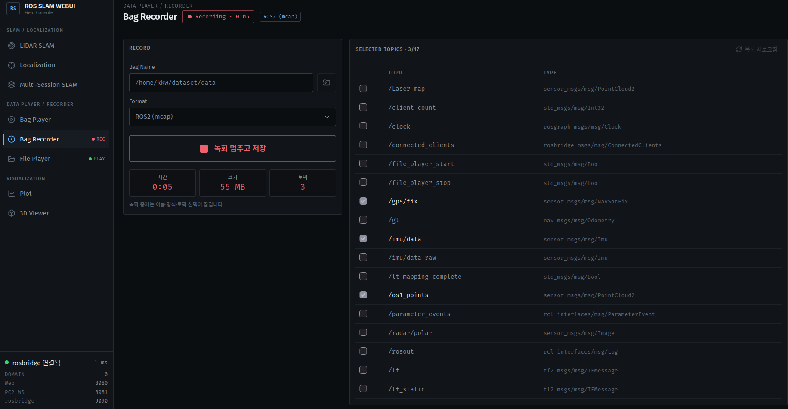
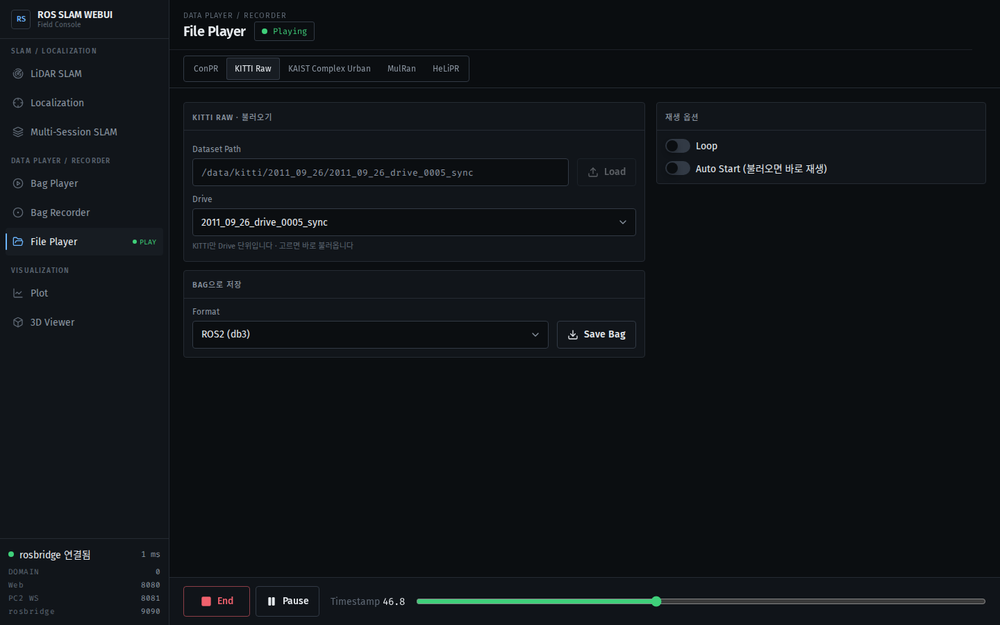
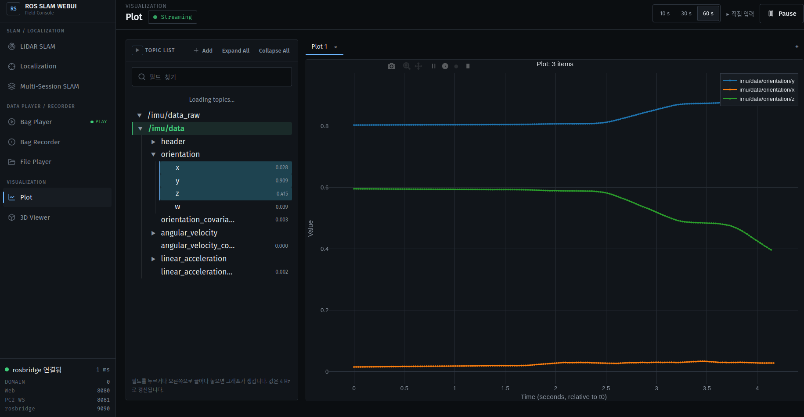
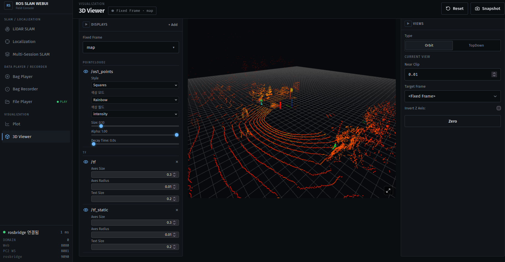

# ROS SLAM WEBUI

Web console for LiDAR SLAM on ROS 2. One browser page runs mapping, localization, bag play and record, dataset playback, plots, and a 3D view. The current UI is the Field Console: a sidebar for the eight screens, and a live map that appears after you press Start.

<p align="center">
  <a href="https://docs.ros.org/en/jazzy/"></a>
  <a href="https://www.python.org/"></a>
  <a href="LICENSE"></a>
</p>

- [Key Features](#key-features)
- [Detailed Feature Guide](#detailed-feature-guide)
- [Requirements](#requirements)
- [Install and build](#install-and-build)
- [Run](#run)
- [Optional environment variables](#optional-environment-variables)
- [License](#license)

<p align="center">
  
</p>

## Key Features

- Run SLAM from the browser: start mapping, watch the live map, and save the result without a separate RViz session.
- Save Map stays available after the sensor stream pauses or the bag ends, as long as keyframes were recorded.
- See whether a node is running from the sidebar tag and the status badge on each screen.
- Merge two mapping sessions into one map.
- Play and convert ROS 1 `.bag` and ROS 2 bags (mcap or db3), and record the same formats.
- Plot live numeric fields, and view point clouds, paths, and TF in 3D.

## Detailed Feature Guide

### LiDAR SLAM



1. Open **LiDAR SLAM**. Check the config, or use **Config Load** / **Set Config File**.
2. Press **Start SLAM**. The live viewer and analytics appear. The badge reads **Running**, and the sidebar shows **RUN**.
3. When keyframes exist, **Save Map** turns on. It stays on if the data later pauses or the bag stops.
4. After the save finishes, the result viewer opens (LIO map, optimized map, trajectories).
5. Press **Stop SLAM** to end the run.

The stepper is Config → Mapping → Save Map → Result. **Save Map** is the current step once there is something to save.

### Localization



1. Open **Localization** and set `map_file_path` (or **Config Load**).
2. Press **Start Localization**. The live viewer opens.
3. The badge moves from initialize to **Tracking** after the map match starts.
4. While it is running, the crosshair on the viewer (**초기 위치 지정**) lets you set the start pose. It is disabled when localization is stopped.

### Multi-Session SLAM



1. Pick **Map 1** and **Map 2**. Each folder must be a Save Map result (`Scans/`, `optimized_poses.txt`, `edges.txt`, `StaticMap.pcd`).
2. Type an output folder name.
3. Press **Multi Session Optimization**. The progress list and the result viewer follow the run.

**Multi Session Optimization** stays disabled until both maps and a safe output name are set.

### Bag Player



1. Press **Load Bag File** and choose a ROS 2 bag folder (mcap or db3) or a ROS 1 `.bag`.
2. Tick the topics to play. **Play** starts playback; the button label becomes **Stop**. **Pause** holds it.
3. Drag the timeline, pick a rate (`0.5×`–`4×`), or turn on **Loop**.
4. **Convert** writes the selected topics to the other bag format.

While the bag is playing, the **Hz** column is the live rate. When it is stopped, that column shows the bag's average rate, dimmed.

### Bag Recorder



1. Set **Bag Name** and **Format**: ROS 2 (mcap), ROS 2 (db3), or ROS 1 (`.bag`).
2. Refresh the topic list and tick what to record.
3. Press **Record**. The badge shows **Recording**, and time, size, and topic count update.
4. Press the same button again to stop and save. The sidebar shows **REC** during the recording.

Topic checkboxes are locked while recording.

### File Player



1. Choose a dataset: ConPR, KITTI Raw, KAIST Complex Urban, MulRan, or HeLiPR.
2. Press **Load** and pick the dataset folder. For KITTI, KAIST, MulRan, and HeLiPR, pick a drive or sequence.
3. Press **Play**. **Pause** and the timeline work like the bag player. **Loop** and **Auto Start** are optional.
4. Pick a format and press **Save Bag** to write a ROS 2 or ROS 1 bag.

### Plot



1. Open **Plot**. Press **Add** and pick topics. Fields show up in the topic list.
2. Drag a numeric field onto the plot. Several fields can share one plot.
3. **Pause** freezes the traces. **10 s / 30 s / 60 s** sets the time window.

rosbridge must be connected or the topic list stays empty.

### 3D Viewer



1. Open **3D Viewer**. **Fixed Frame** defaults to `map`.
2. Press **Add** and choose a display: PointCloud2, Path, Odometry, TF, Livox, Image, or LaserScan, then a topic.
3. **Orbit** or **TopDown** sets the camera. **Snapshot** saves the view. **Reset** clears the displays.

Point clouds use the WebSocket on port 8081. Other displays use rosbridge.

## Requirements

Ubuntu 24.04. Install only what you use. Commands below match packages this repo actually imports or launches.

**ROS 2 Jazzy.** Follow the [Jazzy install guide](https://docs.ros.org/en/jazzy/Installation.html), then:

```bash
sudo apt install ros-jazzy-desktop
```

That provides the ROS dependencies in `package.xml` (`rclpy`, `std_msgs`, `std_srvs`, `sensor_msgs`, `geometry_msgs`, `rosgraph_msgs`, `rosbag2_py`, `cv_bridge`) and the extra messages `web_server.py` imports (`nav_msgs`, `tf2_msgs`).

**rosbridge** (launch file starts it for Plot and the 3D viewer):

```bash
sudo apt install ros-jazzy-rosbridge-suite
```

**mcap bags.** The recorder's default format is mcap (`ros2 bag record` with no `-s` flag). db3 passes `-s sqlite3`.

```bash
sudo apt install ros-jazzy-rosbag2-storage-mcap
```

**Python packages** imported by `web_server.py` and the dataset converters. These apt names exist on Ubuntu 24.04:

```bash
sudo apt install python3-yaml python3-numpy python3-opencv python3-websockets
```

Optional, same file: `psutil` (CPU/RAM numbers) and `ruamel.yaml` (keeps YAML comments). Without them the server still starts.

```bash
sudo apt install python3-psutil python3-ruamel.yaml
```

**ROS 1 bags.** `rosbags` is not in apt. Bag Player, Recorder, and Convert import it for `.bag` read, write, and conversion:

```bash
pip install rosbags
```

**Livox, only if you use that sensor.** `package.xml` depends on `livox_ros_driver2`. It is not in the Jazzy apt archive; put that package in the workspace yourself.

**SLAM stacks, only for those screens.** The server launches `fast_lio` (`mapping.launch.py`, `localization.launch.py`) and `long_term_mapping` (`lt_mapper.launch.py`), and imports `pose_graph_optimization` for Save Map.

```bash
cd ~/localization_ws/src
git clone https://github.com/Kimkyuwon/fast_lio2_mapping_and_localization.git
git clone https://github.com/Kimkyuwon/Pose_Graph_Optimization.git
git clone https://github.com/Kimkyuwon/long_term_mapping.git
```

From the workspace, after ROS is sourced:

```bash
cd ~/localization_ws
rosdep install --from-paths src --ignore-src -r -y
```

## Install and build

```bash
cd ~/localization_ws
source /opt/ros/jazzy/setup.bash
colcon build --packages-select ros_slam_webui --symlink-install
source install/setup.bash
```

## Run

```bash
ros2 launch ros_slam_webui ros_slam_webui.launch.py
```

Open http://localhost:8080 . The launch file also starts rosbridge. If rosbridge is already running, use `start_rosbridge:=false`.

If port 8080 is taken, set another port (below) instead of stopping a server you did not start.

## Optional environment variables

| Variable | Default | Role |
| --- | --- | --- |
| `WEBUI_PORT` | `8080` | Web page |
| `WEBUI_PC2_PORT` | `8081` | Point-cloud WebSocket |
| `WEBUI_ROSBRIDGE_PORT` | `9090` | Port shown to the page for rosbridge |

Set them in the same shell before `ros2 launch`. The page reads the values from the server.

## License

Apache License 2.0. See [LICENSE](LICENSE).
